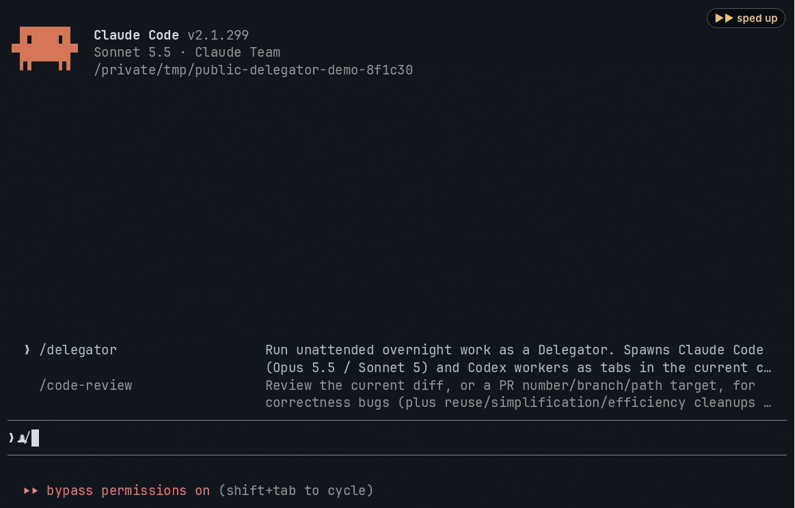
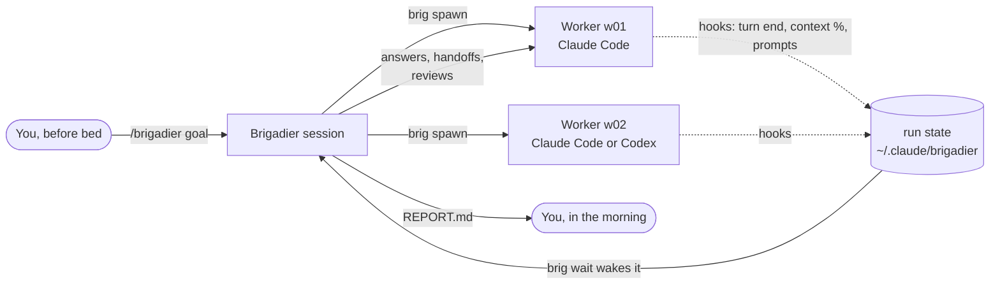

# Brigadier

**Hand Claude Code a goal before bed. Wake up to commits, verified phases and a report.**

[](https://github.com/syncra-studio/brigadier-skill/actions/workflows/ci.yml)
[](LICENSE)
[](https://skills.sh)

Brigadier is a Claude Code skill that keeps work moving while you sleep. It runs a crew of Claude Code workers (plus Codex workers, if you have Codex) in your terminal and answers their questions from your plan. It swaps each worker for a fresh session before its context fills, reviews every phase, and leaves you a morning report.

**Runs in any terminal.** Uses cmux or tmux if you have them, and starts tmux in the background if you don't.



## Install

Two steps on macOS, Linux or Windows.

**1. Install the skill**, with [skills.sh](https://skills.sh):

```sh
npx skills add syncra-studio/brigadier-skill -g -a claude-code
```

Or as a Claude Code plugin:

```text
/plugin marketplace add syncra-studio/brigadier-skill
/plugin install brigadier-skill@brigadier-skill
```

Pick one of the two. Either way you get the `/brigadier` command (as a plugin it's also `/brigadier-skill:brigadier`).

**2. In Claude Code, run `/brigadier setup`.** That's the only setup step. On Windows, run it in a wmux tab; if you don't have wmux yet, setup tells you which one to get (see [Windows](#faq)). It checks `git`, `jq`, `claude`, your terminal (cmux or tmux; wmux on Windows) and the optional `codex`. Then it creates a commented-out `~/.claude/brigadier/config.env`, fixes Windows line endings in the skill's files, and finishes by running `/brigadier doctor`. Anything missing comes back as one exact command for your system (`brew install …`, `sudo apt install …`, `winget install …`). Setup runs those commands only when you say yes; a `sudo` command that would need your password is left for you to type. It's safe to run again at any time.

## 60-second quick start

1. In Claude Code, run **`/brigadier setup`** (see Install). Later, `/brigadier doctor` re-checks the machine without changing anything.
2. Try a tiny goal in a scratch repo:
   ```text
   /brigadier In this repo, add hello.txt containing "hi" and commit it. One phase only; stop after it.
   ```
3. Watch a worker open in a new tab (cmux, wmux), a new window (tmux), or a background tmux session. The brigadier tells you the `tmux attach -t brigadier-<slug>` line to watch it, and `Ctrl-b d` leaves without stopping anything.
4. When it's done, read `~/.claude/brigadier/runs/<run-id>/REPORT.md`. To continue a run later, use `/brigadier resume`: with one unfinished run in this repo it picks that one up, otherwise it lists the runs and asks.

Then give it a real night's work. Good goals look like this:

```text
/brigadier Implement phases 2-4 of docs/PLAN.md. Stop after Phase 4 or at 07:30.

Rules:
- Work on main in small commits. Never push.
- Each phase starts with an outline; wait for "Go ahead." before building.
- Don't add dependencies the plan doesn't name.

Done when (per phase): the phase's "done when" list in docs/PLAN.md passes, with the commands shown in the report.
```

## How it works



- **One brigadier, a few workers.** Your session becomes the brigadier. It doesn't write code. Each worker is a full, separate Claude Code (or Codex) session in its own terminal tab or window, with its own context window.
- **It waits cheaply.** `brig wait` blocks in the background until something needs attention, so the brigadier spends almost nothing while workers work.
- **It answers for you, within limits.** Questions and outline approvals get answers from your plan, CLAUDE.md and the goal's rules. Every answer is logged under "Decided on your behalf". Pushes, payments, sign-ups, credentials and messages to people are never approved; they're listed under "Waiting on you".
- **Fresh sessions, not compaction.** When a worker's context passes the threshold, it writes a handoff and a successor picks up from it. The brigadier does the same for itself.
- **Every phase is verified.** A fresh worker reviews the phase's diff (Codex if installed, otherwise a read-only Claude session), checks every "done when" item for real, and fixes what it finds.

| Event from `brig wait` | What the brigadier does |
|---|---|
| `TURN_END wN status=working` | reads the question or outline, reviews plans, answers |
| `TURN_END wN status=done` | checks the report against "done when", closes the worker, verifies the phase |
| `CTX_HIGH` / `COMPACTING` | asks for a handoff, starts a successor with `--continues` |
| `NEEDS_INPUT` | answers a permission prompt with `brig key` if its rules allow, otherwise denies |
| `TRUST_PROMPT` | a worker waits at Claude Code's "trust this folder" dialog: accepts it with `brig trust` for the run's own repo, otherwise closes the worker and lists the folder under "Waiting on you" |
| `INTERRUPTED` / `STALL` / `GONE` | checks the screen, nudges, or replaces the worker |
| `RATE_LIMIT` | stops spawning Claude workers, moves bounded work to Codex if available, sleeps until the reset |
| `REBIRTH_DUE` | hands the run to a fresh brigadier session, which confirms before the old one exits |

## Terminals

| You run Claude Code in… | Brigadier uses | Workers appear as |
|---|---|---|
| [cmux](https://cmux.com) | cmux | tabs in your workspace |
| tmux | tmux (attached) | windows in your session (`Ctrl-b w` to pick one) |
| Terminal.app, iTerm, Ghostty, VS Code, an SSH shell… | tmux (background) | windows in a detached session `brigadier-<slug>` (`tmux attach -t brigadier-<slug>`) |
| Windows: [amirlehmam/wmux](https://github.com/amirlehmam/wmux) (recommended) | wmux | tabs in your workspace |
| Windows: [openwong2kim/wmux](https://github.com/openwong2kim/wmux) (fallback) | wmux-ow | tabs in your workspace |

No tmux? `/brigadier setup` prints the one-line install for your system (`brew install tmux`, `sudo apt install tmux`, …). Zellij, WezTerm and kitty backends are welcome as contributions; each is one small file (see [CONTRIBUTING.md](CONTRIBUTING.md)).

## Configuration

All settings live in one file, `~/.claude/brigadier/config.env`. `/brigadier setup` creates it from [`config.example.env`](skills/brigadier/config.example.env) with every setting commented out; uncomment what you want to change. A run can override settings in `<run>/config.env`, and environment variables override both. A run may tighten `BRIG_MAX_EFFORT` and `BRIG_ALLOWED_MODELS` but never loosen them. `/brigadier doctor` checks the file, and `/brigadier config` shows the effective values and where each one came from.

| Setting | Default | What it does |
|---|---|---|
| `BRIG_BACKEND` | `auto` | `cmux`, `tmux`, `wmux`, `wmux-ow`, or auto-detect |
| `BRIG_DEFAULT_MODEL` | `opus` | model for workers; the reborn brigadier uses the value from this file or the environment (a model named in the goal covers the workers only, and keeps Codex workers out unless the goal names Codex) |
| `BRIG_CHORE_MODEL` | `sonnet` | model suggested for mechanical chores |
| `BRIG_ALLOWED_MODELS` | `*` | allowlist, e.g. `"opus sonnet"`; enforced for workers and their subagents |
| `BRIG_DEFAULT_EFFORT` / `BRIG_MAX_EFFORT` | `high` / `high` | effort for workers, and the ceiling nothing may exceed (Claude and Codex) |
| `BRIG_MAX_WORKERS` | `3` | most workers at once |
| `BRIG_CTX_PCT` / `BRIG_CTX_TOKENS` | `70` / `300000` | hand a worker off at whichever comes first |
| `BRIG_SELF_TOKENS` | `150000` | the brigadier's own handoff point |
| `BRIG_STALL_MIN`, `BRIG_IDLE_SEC`, `BRIG_RATE_PCT` | `30`, `120`, `95` | watchdog thresholds |
| `BRIG_CODEX` | `auto` | use Codex when it's on PATH; `off` to never use it |
| `BRIG_REVIEWER` | `auto` | `codex`, `claude`, or `off` |
| `BRIG_PERMISSION_MODE` | `bypassPermissions` | permission mode of Claude workers and of the reborn brigadier (see Safety) |
| `BRIG_CODEX_SANDBOX` | `workspace-write` | Codex workers: `workspace-write` (sandboxed, network on) or `bypass` (see Safety) |
| `BRIG_CLAUDE_CONFIG_DIR` | — | run new workers under another Claude Code config dir |

## Safety & cost

Read this before your first night.

- **Claude workers run unattended with permissions bypassed by default** (`--permission-mode bypassPermissions`). So does the fresh brigadier session a rebirth starts, whatever mode you started the first one in, because nobody is there to approve its prompts. That's what lets work continue while you sleep, and it means a Claude worker can run any command your user account can. Run Brigadier on repos and machines where that's acceptable. To be stricter, set `BRIG_PERMISSION_MODE` to `acceptEdits`, `auto`, `dontAsk` or `manual`. Prompts then reach the brigadier, which approves only what its rules allow.
- **Folder trust stays yours.** A worker in a folder Claude Code hasn't trusted yet stops at its "trust this folder" dialog. `brig spawn` warns about that up front (it reads Claude Code's `.claude.json` and never writes it), and the brigadier accepts the dialog only for the run's own repo or a worktree or subfolder of it.
- **Codex workers run in Codex's sandbox by default** (`BRIG_CODEX_SANDBOX=workspace-write`). They can write the repo, its git dirs and their own control dir, with network on and no prompts. `BRIG_CODEX_SANDBOX=bypass` runs them without the sandbox. Messages to a Codex worker are accepted only from `brig send`, which signs each one with a per-worker token; anything else dropped in its inbox is refused and reported. `/brigadier doctor` prints both settings.
- **Its rules forbid pushing, publishing, deploying, spending money, signing up for anything or contacting anyone on your behalf.** Workers stub those and the report lists them under "Waiting on you". The worker protocol also bans killing processes by name and deleting other runs' scratch files. These are instructions the sessions follow, not a sandbox: with permissions bypassed, nothing technically stops a worker that ignores them.
- **It uses your own subscription quota.** Every worker is a normal Claude Code (or Codex) session on your account, so a night of work uses your plan's limits like a day of work would. When the 5-hour window passes `BRIG_RATE_PCT` (95%), the brigadier stops starting Claude workers and waits for the reset. If you also run the Brigadier app at the same time, both share that one subscription's 5-hour window.
- **It drives your own, unmodified `claude` and `codex` binaries in your own terminal.** No tokens are shared or proxied, there's no API intermediary, and nothing is sent anywhere except by those official CLIs. Run state stays in `~/.claude/brigadier/` on your machine.
- **Keep the machine awake.** A sleeping laptop stops the run. On macOS, `caffeinate -dimsu` in a spare tab works.

## FAQ

**Do I need Codex?** No. Everything works with Claude Code alone. If `codex` is installed, Brigadier also uses it as a second reviewer and for bounded tasks, which helps when Claude's 5-hour window runs out.

**Which plan or model do I need?** Any Claude Code setup works. Workers use `opus` by default. If your plan doesn't include it, set `BRIG_DEFAULT_MODEL=sonnet`.

**How is this different from subagents?** Subagents live inside one session and return when the session's turn ends. Brigadier workers are separate full sessions, each with its own context window. They run for hours, get replaced before their context fills, and leave a paper trail (task, report, handoff) for every step.

**Can I watch or step in?** Yes. Open any worker's tab or window and read along. To change direction, tell the brigadier session; it speaks to the workers. `/brigadier resume` picks a run up again after a restart.

**Can I run two at once?** Yes, in different repos or tabs. Each brigadier session is bound to its own run.

**Does it work on Linux, WSL or a remote server?** Yes, through tmux. CI runs on Ubuntu and macOS. WSL should work the same way, but it isn't tested yet.

**Windows?** Yes, with Git for Windows and wmux. Claude Code runs its shell commands through Git Bash, and Brigadier needs that Bash; `winget install --id Git.Git -e --source winget` installs it. Workers open as wmux tabs, so start Claude Code inside wmux:
- [amirlehmam/wmux](https://github.com/amirlehmam/wmux) is the recommended one. Download the setup `.exe` from its [releases](https://github.com/amirlehmam/wmux/releases/latest) (Brigadier is tested against 2.24.0).
- [openwong2kim/wmux](https://github.com/openwong2kim/wmux) works as the fallback: `winget install --id openwong2kim.wmux -e --source winget` (tested on a real PC with 4.3.0; the backend was written against the 4.5.0 source). Brigadier drives it through its RPC pipe with PowerShell. Tabs keep wmux's own titles there, and only tabs in your current workspace are tracked. Its approval gate refuses keys at a numbered permission prompt unless you let automation answer approvals in that workspace, so with a stricter `BRIG_PERMISSION_MODE` such a prompt waits for you.

Then run `/brigadier setup` in a wmux tab. It finds `jq` and the other tools winget installed even before a restart, and tells you when wmux or Claude Code needs one. Brigadier picks the right wmux by itself; `BRIG_BACKEND=wmux` or `wmux-ow` forces one. The Windows support has run on a real PC with openwong2kim/wmux 4.3.0; amirlehmam/wmux is tested only with a fake so far, so please report what you run into. Codex on Windows hasn't been tried with Brigadier.

**Where does state live, and how do I uninstall?** Runs live in `~/.claude/brigadier/runs/`. Remove the skill with `npx skills remove -g brigadier`, or with `/plugin uninstall brigadier-skill@brigadier-skill`. Then delete `~/.claude/brigadier/` if you want the run history gone.

**Does it work inside the Brigadier app?** No, on purpose. The app has its own Overnight mode, and the skill stops with a one-line pointer to it.

---

Brigadier has a big sibling: the [Brigadier app](https://github.com/syncra-studio/brigadier-ai).

[Contributing](CONTRIBUTING.md) · [Security](SECURITY.md) · [Changelog](CHANGELOG.md) · [MIT License](LICENSE)
